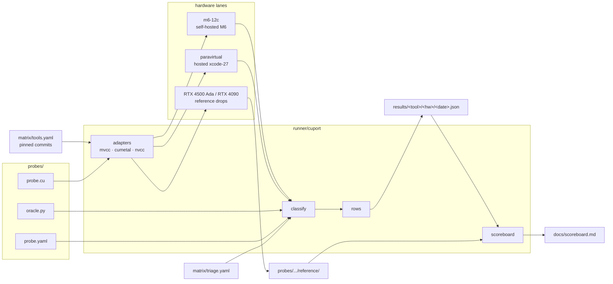
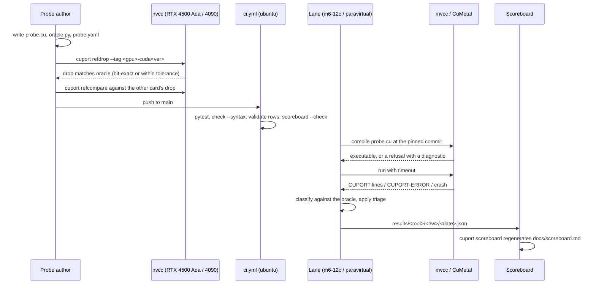
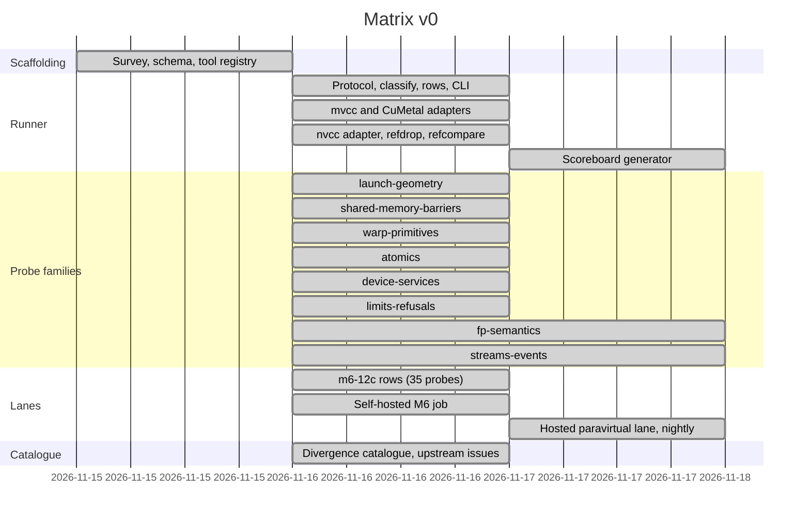

# Cuport-Matrix

[](https://github.com/guru-bharadwaj20/Cuport-Matrix/actions/workflows/ci.yml)
[](https://github.com/guru-bharadwaj20/Cuport-Matrix/actions/workflows/matrix.yml)


A conformance and divergence matrix for CUDA on Apple GPUs: one plain-CUDA
probe corpus, run unchanged through several CUDA-on-Metal tools on several
Apple hardware lanes, with every cell classified.

## Contents

- [What it does](#what-it-does)
- [Architecture](#architecture)
- [How a probe travels](#how-a-probe-travels)
- [Quick start](#quick-start)
- [Project status](#project-status)
- [Design decisions](#design-decisions)
- [Repository layout](#repository-layout)
- [Documentation](#documentation)
- [Team](#team)
- [License](#license)

## What it does

Several projects compile or run CUDA on Apple silicon, and each one reports
its own pass counts on its own tests and hardware. Cuport-Matrix runs the same
probes through all of them on the same machines and records where they agree
with CUDA, where they diverge, and whether the divergence is documented.

| Piece | What it is |
|---|---|
| Probe corpus | 42 probes in 8 families under `probes/`, each a `probe.cu`, an `oracle.py`, a `probe.yaml` and a README |
| Oracles | The CUDA specification, a CPU reference, or a committed reference vector. Running the matrix needs no NVIDIA GPU |
| Runner | `python -m cuport` compiles and runs every probe through a tool adapter and writes one JSON row per tool, hardware and date |
| Classes | `bit-exact`, `within-tolerance`, `documented-divergence`, `undocumented-divergence`, `refused-with-diagnostic`, `silently-wrong`, `crash-hang`, `not-run` |
| Lanes | `m6-12c` (self-hosted Apple M6 Mac mini, 12-core GPU) and `paravirtual` (GitHub-hosted `xcode-27` runner, nightly) |
| NVIDIA reference drops | Stock `nvcc` output from an RTX 4500 Ada and two RTX 4090s, showing that real CUDA passes each probe's oracle |
| Scoreboard | `docs/scoreboard.md`, generated from `results/`; CI fails when it is stale |
| Divergence catalogue | `docs/divergences.md`: every divergent cell, checked against the tool's source, with its upstream issue |

The probe families:

| Family | Probes | Covers |
|---|--:|---|
| `launch-geometry` | 5 | thread and block indexing, 3D dims, large grids, zero-size launch, dynamic shared size |
| `shared-memory-barriers` | 5 | static and dynamic shared arrays, `__syncthreads` reductions, the 32 KB boundary, `__syncthreads_count/and/or` |
| `warp-primitives` | 6 | `__shfl_*_sync`, xor with width, ballot/any/all, `__match_any_sync`, partial-warp masks |
| `atomics` | 5 | int and float `atomicAdd`, CAS loops, unsigned min/max, contended shared atomics, 64-bit atomics |
| `fp-semantics` | 8 | fma contraction, fast-math intrinsics, denormals, FP64 emulation, half/bf16 conversions, rounding-mode intrinsics |
| `streams-events` | 4 | stream ordering, event timing, async copy overlap, default-stream sync |
| `device-services` | 4 | `printf`, `clock64`, `assert`, device `malloc/free` |
| `limits-refusals` | 5 | inline PTX, oversized shared, cooperative grid sync, texture objects, dynamic parallelism |

## Architecture



A probe is plain CUDA C++. It draws its inputs from a 64-bit LCG seeded with
the FNV-1a hash of its id and prints its buffers as raw bits
(`CUPORT <name> <dtype> <count> <hex>...`). The oracle draws from the same
stream and computes the expected buffers in Python, so no NVIDIA GPU is
needed. An adapter compiles and runs the probe with one tool; `classify`
compares the output with the oracle, and `matrix/triage.yaml` applies human
triage (documented versus undocumented, upstream link). The `nvcc` adapter
runs the same probes on NVIDIA cards and stores the output as reference drops,
which show that the oracle agrees with real CUDA.

## How a probe travels



## Quick start

```bash
git clone https://github.com/guru-bharadwaj20/Cuport-Matrix
cd Cuport-Matrix
python -m venv .venv && .venv/bin/pip install -r runner/requirements.txt
export PYTHONPATH=runner            # on Windows: set PYTHONPATH=runner

# Anywhere: tests, probe metadata, oracles, a clang parse of every probe
.venv/bin/python -m pytest runner -q
.venv/bin/python -m cuport list
.venv/bin/python -m cuport check --syntax

# On a Mac: build the pinned tools, then run the matrix
.github/scripts/build-tools.sh all          # into ~/.local/cuport-tools
.venv/bin/python -m cuport run --tool mvcc --hardware m6-12c
.venv/bin/python -m cuport validate results/*/*/*.json

# On an NVIDIA machine: capture and compare reference drops
.venv/bin/python -m cuport refdrop --tag rtx4500ada-cuda13.5
.venv/bin/python -m cuport refcompare --a rtx4500ada-cuda13.5 --b rtx4090-cuda12.6

# Regenerate the scoreboard from results/
.venv/bin/python -m cuport scoreboard
```

## Project status

Milestone v0 (scope in `docs/survey-2026-11-15.md`, section 6) is built: all
42 probes, both tool adapters, the `nvcc` reference lane, both Apple lanes,
the scoreboard and the divergence catalogue. What remains is mostly runs on
hardware only one team member has.



| Phase | State |
|---|---|
| Runner, schema, adapters (mvcc, CuMetal, nvcc) | done |
| 42 probes in 8 families, every oracle checked by `cuport check` | done |
| NVIDIA reference drops (`rtx4500ada-cuda13.5`, `rtx4090-cuda12.6`), every pair compared agrees | done |
| `m6-12c` rows for both tools | done for the first 35 probes |
| Hosted `paravirtual` lane, nightly, commits its own rows | done |
| Scoreboard with v0 criteria and hosted-vs-M6 disagreement rate | done |
| Divergence catalogue; 5 upstream issues (mvcc#20, #21; cuda-metal#205, #206, #207) | done |

From the first hosted run (2026-11-17), 154 of 168 v0 cells are classified
(91.7 %, target 90 %). The hosted-vs-M6 disagreement rate is **26 of 70
probes (37.1 %)**: mvcc 25 of 35 (71.4 %), CuMetal 1 of 35 (2.9 %). On the
paravirtual GPU most mvcc kernels leave their output buffers untouched, so
probes that are bit-exact on the M6 read back zeros; the cause is not yet
investigated. The per-probe list is in [docs/scoreboard.md](docs/scoreboard.md).

### 4 things remain open

| Item | Owner | Why it is open |
|---|---|---|
| `m6-12c` rows for the 7 newest probes (`fp-semantics` fma-contraction, denormals, fp64-emulation, half-bf16, rounding-modes; `streams-events` event-timing, default-stream-sync) | Vivian (M6) | The M6 is the only real Apple silicon lane; the rows land with the next M6 run |
| RTX 4090 reference drops for the same 7 probes | Vivian (RTX 4090s) | The RTX 4500 Ada drops exist; a second card is needed for the two-card check |
| Self-hosted runner registration token | Guru, then Vivian | Needs repo admin: `gh api -X POST repos/guru-bharadwaj20/Cuport-Matrix/actions/runners/registration-token`, then `docs/m6-runner.md` |
| Linux negative control for `streams-events/default-stream-sync-001` | either, on a Linux NVIDIA box | Under WDDM on Windows the non-blocking and per-thread-stream variants also serialise, so the control could not show a race there |

### What CI proves

| Check | Workflow | Where it runs |
|---|---|---|
| Runner unit tests pass | `ci.yml` | ubuntu, every push and PR |
| Every `probe.yaml` is valid and every oracle evaluates | `ci.yml` (`cuport check`) | ubuntu |
| Every `probe.cu` parses with clang (host and device) against `runner/cuda_stub`; `dynamic-parallelism-001` is host-only, since clang has no device-side launch | `ci.yml` (`check --syntax`) | ubuntu |
| Every committed row matches `matrix/schema.md` | `ci.yml` (`cuport validate`) | ubuntu |
| `docs/scoreboard.md` matches the committed rows | `ci.yml` (`scoreboard --check`) | ubuntu |
| Both tools build from their pinned commits and run every probe on Apple's paravirtual GPU | `matrix.yml`, hosted job | GitHub `xcode-27`, nightly 03:17 UTC and on dispatch |
| Both tools run every probe on real Apple silicon | `matrix.yml`, `m6: true` | self-hosted M6, on dispatch |

## Design decisions

- **Oracles never need an NVIDIA GPU.** Expected values come from the CUDA
  specification, a CPU reference or a committed vector. NVIDIA drops show
  that real CUDA passes; they are not the comparison target.
- **Deterministic inputs.** One LCG, seeded by the FNV-1a hash of the probe
  id, shared by `probe.cu` and `oracle.py`. No clocks, no files, no random
  seeds.
- **Raw bits, not printf.** Buffers are printed as hex bit patterns, so float
  comparison never depends on formatting.
- **Exact rounding in the oracle.** `fp-semantics` oracles round exact
  rationals once in the requested direction (`probes/common/cuport_oracle.py`),
  so a bit-exact claim is checked against the correctly rounded value.
- **Lanes are never merged.** The paravirtual GPU is a feature subset of real
  silicon, so its rows stay under `paravirtual` and the scoreboard reports
  how often it disagrees with the M6 instead of folding it in.
- **Divergence is triaged, not just counted.** A divergence is
  `undocumented-divergence` only after it is reported upstream, and
  `matrix/triage.yaml` records the link.
- **Everything is pinned.** Tools are built from exact commits in
  `matrix/tools.yaml`; every row records the repo commit it ran from.
- **No vendor binaries.** No fatbins, PTX, SASS or `cuobjdump` output is
  committed.
- **Native Metal baselines** in `baselines/metal/` separate hardware
  behaviour from tool behaviour; they are never used as oracles.

## Repository layout

```
.github/
  workflows/ci.yml        GPU-free checks on ubuntu
  workflows/matrix.yml    hosted paravirtual lane (nightly) and self-hosted M6 lane
  scripts/                build-tools.sh, hosted-lane.sh, m6-lane.sh
baselines/metal/          native Metal kernels mirroring selected probes
docs/
  scoreboard.md           generated; do not edit
  divergences.md          every divergent cell with its explanation and issue
  m6-runner.md            registering and running the self-hosted M6 runner
  survey-2026-11-15.md    opportunity survey and milestone v0 scope
matrix/
  features.yaml           feature catalogue, by family
  tools.yaml              tool registry with pinned commits
  schema.md               result-row schema, classes, evidence labels, ground rules
  triage.yaml             human triage of divergent cells
probes/
  common/                 cuport.h, cuport_oracle.py
  <family>/<name>-NNN/    probe.cu, oracle.py, probe.yaml, README.md, reference/
results/<tool>/<hw>/      one JSON row per date
runner/
  cuport/                 runner package and adapters (mvcc, cumetal, nvcc)
  cuda_stub/              declaration-only CUDA headers for the clang syntax check
  tests/                  unit tests
tools/fastmath-sweep/     full-range sweep of fast-math intrinsics on NVIDIA
```

## Documentation

| Question | File |
|---|---|
| What does each tool get right and wrong right now? | [docs/scoreboard.md](docs/scoreboard.md) |
| Why does a cell diverge, and is it filed upstream? | [docs/divergences.md](docs/divergences.md) |
| What is in a result row; what do the classes and evidence labels mean? | [matrix/schema.md](matrix/schema.md) |
| How do I write a probe or capture an NVIDIA reference drop? | [probes/README.md](probes/README.md) |
| Which tool versions are pinned? | [matrix/tools.yaml](matrix/tools.yaml) |
| How do I register or run the M6 runner? | [docs/m6-runner.md](docs/m6-runner.md) |
| Why does this project exist, and what is v0? | [docs/survey-2026-11-15.md](docs/survey-2026-11-15.md) |
| How were the fast-math tolerances measured? | [tools/fastmath-sweep/README.md](tools/fastmath-sweep/README.md) |
| What do the Metal baselines show? | [baselines/metal/README.md](baselines/metal/README.md) |

> [!CAUTION]
> This is a conformance and divergence matrix, not a certification. There is
> no CUDA-on-Metal specification to conform to: the matrix measures agreement
> with CUDA semantics and between tools on a 42-probe corpus. Do not quote
> its counts as "X % CUDA compatible". `paravirtual` rows describe GitHub's
> virtual GPU, not any real Mac.

## Team

| Member | Hardware | Work |
|---|---|---|
| Guru R Bharadwaj | RTX 4500 Ada | `device-services`, `limits-refusals`, the remaining `fp-semantics` and `streams-events` probes, RTX 4500 Ada reference drops, the hosted paravirtual lane, the scoreboard generator |
| Vivian Sobers | Apple M6, two RTX 4090s | Runner, schema and adapters, `launch-geometry`, `shared-memory-barriers`, `warp-primitives`, `atomics`, the M6 rows and lane, RTX 4090 drops, fast-math probes and sweep, stream-ordering and async-copy probes, the divergence catalogue and upstream issues |

## License

Apache-2.0. See [LICENSE](LICENSE).
